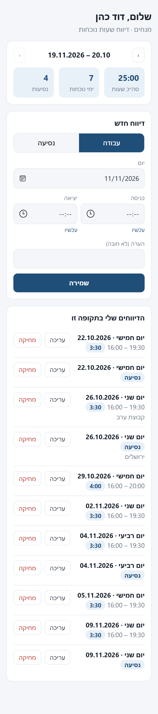
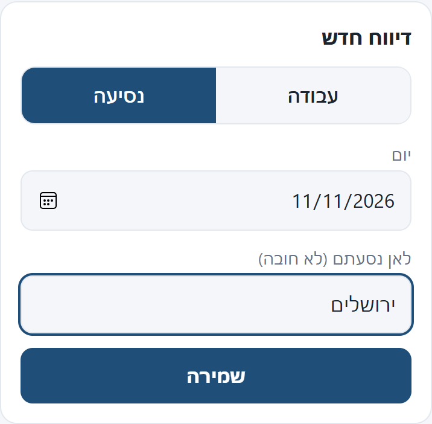
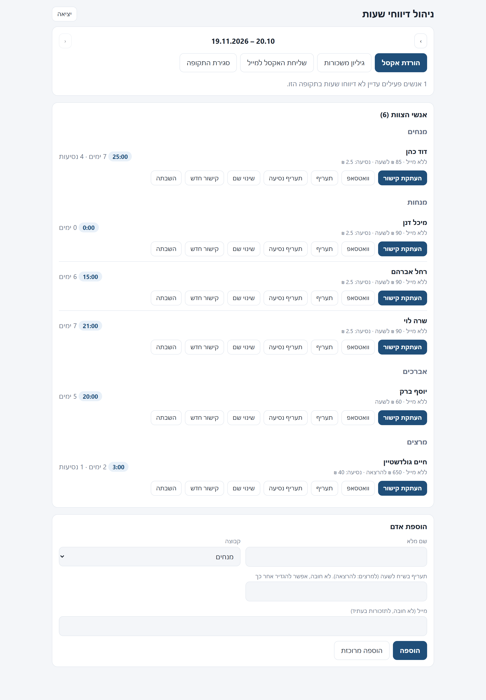
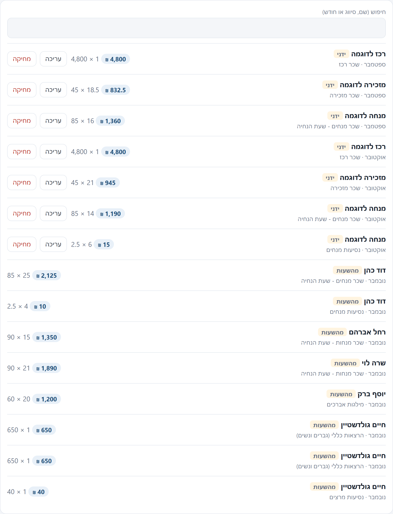
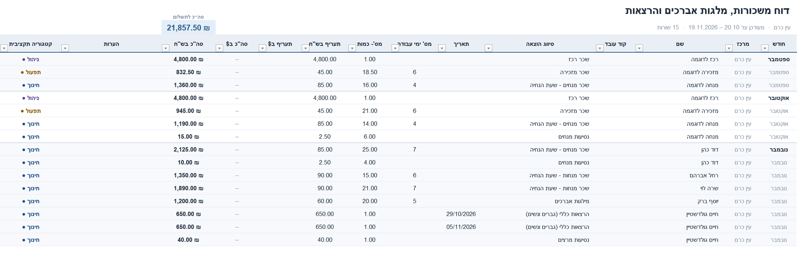
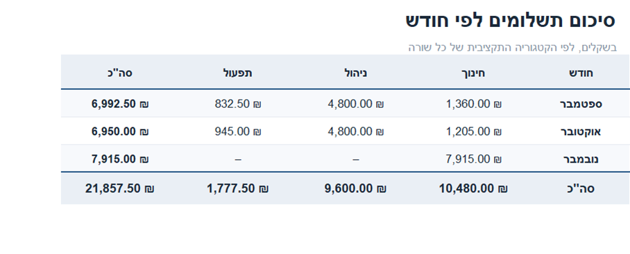
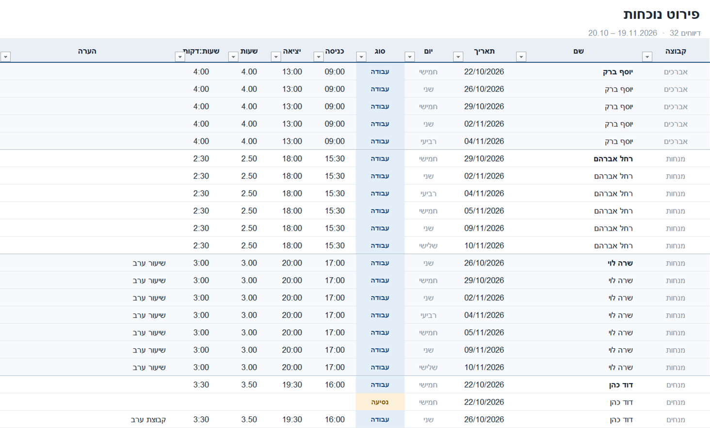
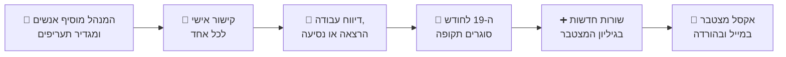
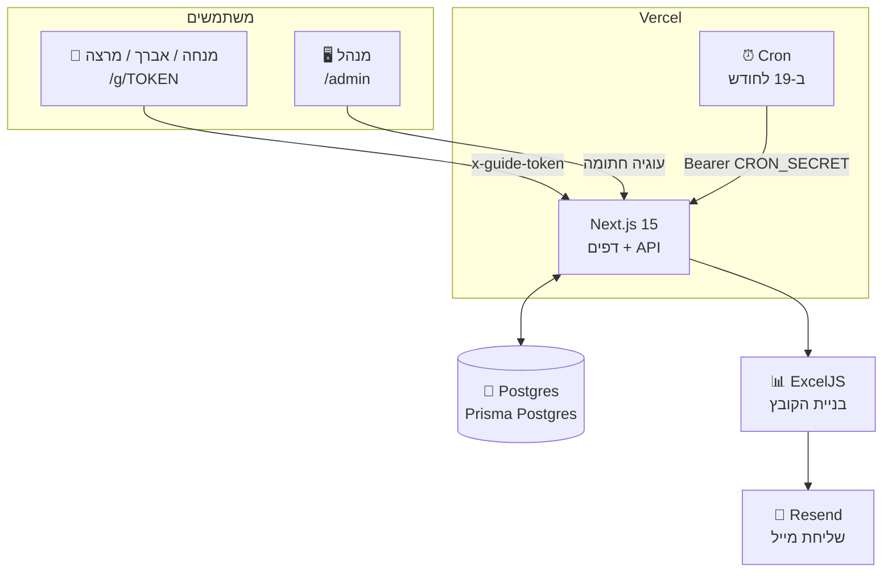

<div dir="rtl" align="right">

# 🕐 דיווח שעות · נפש יהודי, מרכז עין כרם

 -1f4e79)

**מערכת אמיתית שפועלת בפרודקשן ומשמשת את צוות מרכז עין כרם בארגון נפש יהודי: מנחים, מנחות, אברכים ומרצים מדווחים שעות ונסיעות בקישור אישי, והמערכת בונה לבד את גיליון המשכורות המצטבר ואת האקסל שנשלח למשרד.**

### [🌐 לאתר החי](https://ein-karem-timesheet.vercel.app) &nbsp;·&nbsp; [🔐 כניסת מנהל](https://ein-karem-timesheet.vercel.app/admin)

`Next.js 15` · `TypeScript` · `Postgres` · `Vercel` · `ExcelJS` · עברית, RTL ומותאם לנייד

</div>

<br>

<div dir="rtl" align="right">

## מה הבעיה שנפתרה

בארגון נפש יהודי כל מרכז מנהל קובץ אקסל שנתי מצטבר ומגיש אותו בכל חודש למשרד המרכזי. לפני המערכת היו מעתיקים ידנית את כל השורות הקודמות לקובץ חדש בכל חודש, ומוסיפים עליהן את השורות של החודש. עכשיו כל אחד מדווח בעצמו בקישור אישי, והאקסל נבנה לבד **עם כל מה שהיה ועוד השורות החדשות**.

</div>

<br>

<div dir="rtl" align="right">

## 📱 מה רואה כל מנחה

קישור אישי אחד (`/g/<סוד>`), בלי סיסמה ובלי הרשמה. כל אחד רואה **רק את הדיווחים של עצמו**, ויכול להוסיף, לערוך ולמחוק אותם לאורך כל התקופה הפתוחה. בוחרים **עבודה** (או **הרצאה** למרצים) או **נסיעה**: לנסיעה מספיק יום, בלי שעות.

</div>

<table align="center">
  <tr>
    <td align="center" width="38%"><br><sub>מסך הנייד: סיכום שעות, ימים ונסיעות, טופס דיווח ורשימת הדיווחים</sub></td>
    <td align="center" width="38%"><br><sub>המתג עבודה / נסיעה. לנסיעה אין שעות</sub></td>
  </tr>
</table>

<div dir="rtl" align="right">

> צילומי המסך כאן מציגים נתוני הדגמה בדויים, מטעמי פרטיות של העובדים. המערכת עצמה פועלת עם נתונים אמיתיים.

</div>

<br>

<div dir="rtl" align="right">

## 🛠️ מה רואה המנהל

ב-`/admin`: מוסיפים אנשים (גם רשימה שלמה בבת אחת), מעתיקים או שולחים בוואטסאפ את הקישור האישי, קובעים **תעריף אישי** ותעריף נסיעה לכל אחד, רואים מי עוד לא דיווח, מורידים אקסל, וסוגרים תקופה.

</div>

<p align="center"></p>

<br>

<div dir="rtl" align="right">

## 📒 גיליון המשכורות המצטבר

המערכת עצמה היא ה"גיליון". כל שורות השנה נשמרות במסד נתונים, בכל חודש מתווספות שורות חדשות, ושורות של רכזים, מזכירה ונסיעות מוסיפים ידנית ב-`/admin/ledger`. שורה שנוצרה מהשעות היא תמיד מחושבת מהדיווחים, ולכן אי אפשר לערוך אותה ידנית ויוצרים במקומה שורת תיקון.

</div>

<p align="center"></p>

<br>

<div dir="rtl" align="right">

## 📊 האקסל שיוצא

גיליון 1 הוא `משכורות, מילגות אברכים והרצאות` **בדיוק בעמודות של קובץ המשרד** (A עד N, כותרות בשורה 3), עם נוסחאות חיות בעמודות הסכום. הוא כולל את כל השורות עד היום.

</div>

<p align="center"></p>

<table align="center">
  <tr>
    <td align="center" width="45%"><br><sub>גיליון 2: סיכום לפי חודש וקטגוריה תקציבית</sub></td>
    <td align="center" width="55%"><br><sub>גיליון 3: פירוט הנוכחות היומית של התקופה</sub></td>
  </tr>
</table>

<div dir="rtl" align="right">

העיצוב נבדק ב-Excel עצמו: אפסים מוצגים כמקף שקט, קו הפרדה בין חודשים, קטגוריות בצבע, וסכום כולל בולט בראש הגיליון.

</div>

<br>

<div dir="rtl" align="right">

## 🔄 המחזור החודשי

</div>



<div dir="rtl" align="right">

התקופה היא **מ-20 עד 19 בחודש הבא**, כמו בקובץ המשרד (סוגרים ב-20, מגישים עד ה-22). הדוח נקרא על שם החודש שבו התקופה מסתיימת: 20.10 עד 19.11 היא "נובמבר". אפשר לשנות עם `PERIOD_START_DAY`.

ב-19 לחודש (22:00 או 23:00 שעון ישראל) רץ Vercel Cron שמוסיף את שורות התקופה לגיליון, בונה את האקסל, שולח אותו במייל וסוגר את התקופה לעריכה. ההרצה בטוחה לחזרה: אם התקופה כבר סגורה היא לא עושה כלום, ואם המייל נכשל היא **לא** סוגרת ומדווחת שגיאה.

</div>

<br>

<div dir="rtl" align="right">

## 🏗️ ארכיטקטורה

</div>



<div dir="rtl" align="right">

| שכבה | מימוש |
|---|---|
| ממשק | Next.js App Router, React 19, CSS פשוט, עברית RTL ומותאם לנייד |
| שרת | נתיבי API של Next.js, בלי שרת נפרד |
| נתונים | Postgres. מקומית, בלי הגדרות, רץ Postgres מוטמע (PGlite) |
| אקסל | ExcelJS, כל העיצוב בקובץ אחד: `lib/excel.ts` |
| מייל | Resend ב-HTTPS, בלי ספרייה |
| תזמון | Vercel Cron |

</div>

<br>

<div dir="rtl" align="right">

## 🔐 אבטחה ופרטיות

- **קישור אישי הוא ה"סיסמה"** של המנחה: 192 ביט אקראיים, נשלחים בכותרת ולא בכתובת ה-API. אפשר להחליף קישור בלחיצה, והישן מפסיק לעבוד מיד.
- מנחה רואה ומשנה **רק** דיווחים של עצמו. בדוק בבדיקות אוטומטיות שמנחה אחד לא יכול לראות, לערוך או למחוק דיווח של אחר.
- הדפים מסומנים `noindex` ו-`Referrer-Policy: no-referrer`, כדי שהקישור לא ידלוף.
- כניסת מנהל: סיסמה מ-`ADMIN_PASSWORD`, עוגיית `httpOnly` חתומה, והגבלת ניסיונות.
- תקופה סגורה נעולה לעריכה אצל המנחים. המנהל יכול לפתוח אותה מחדש.
- אין תעריפים בקוד. כל תעריף נקבע אצל המנהל לכל אדם, ונשאר ריק עד שהוגדר.
- הקרון מחייב `CRON_SECRET`, ובלעדיו נחסם.

</div>

<br>

<div dir="rtl" align="right">

## ✅ איך נבדק

- **7 בדיקות יחידה** ללוגיקת תקופות, תאריכים ואזור זמן ישראל (`npm test`).
- **27 בדיקות מקצה לקצה** מול שרת רץ (הוראות בראש `scripts/smoke.mjs`): הרשאות, חפיפות שעות, נסיעה מול עבודה, תקופה סגורה, גיליון מצטבר, אקסל, קרון ועוד.
- **השוואה מול קובץ המשרד המקורי ב-Excel עצמו**, תא אחרי תא, כולל הסכומים. נמצאו רק הבדלים מכוונים: קודי עובד שהיו שגיאה (`#N/A`) בקובץ המקורי נוקו, ונוספה קטגוריה תקציבית שהייתה חסרה בשורה אחת.

</div>

<br>

<div dir="rtl" align="right">

## 🚀 הרצה מקומית

</div>

```bash
npm install
cp .env.example .env.local     # ערכו ADMIN_PASSWORD ו-SESSION_SECRET
npm run dev                    # בלי DATABASE_URL רץ Postgres מוטמע בתיקיית .data
```

<div dir="rtl" align="right">

פתחו `http://localhost:3000/admin`, הוסיפו אנשים והעתיקו את הקישורים שלהם.

### משתני סביבה

| משתנה | חובה | תיאור |
|---|:-:|---|
| `DATABASE_URL` (או `POSTGRES_URL`) | בפרודקשן | חיבור ל-Postgres |
| `ADMIN_PASSWORD` | ✅ | סיסמת `/admin` |
| `SESSION_SECRET` | ✅ | חתימת עוגיית המנהל (`openssl rand -hex 32`) |
| `CRON_SECRET` | ✅ | סוד שמגן על נתיב הקרון, Vercel שולח אותו לבד |
| `RESEND_API_KEY`, `MAIL_FROM`, `ADMIN_EMAIL` | לשליחת מייל | בלי אלה הקרון נכשל בכוונה ולא סוגר תקופה. אפשר תמיד להוריד אקסל ידנית |
| `PERIOD_START_DAY` | לא | ברירת מחדל 20. הערך 1 נותן חודש קלנדרי |
| `CENTER_NAME` | לא | שם המרכז בעמודת "מרכז". ברירת מחדל: עין כרם |

### העלאה לפרודקשן (Vercel)

1. ייבאו את הריפו כפרויקט ב-Vercel.
2. הוסיפו מסד Postgres מה-Marketplace (למשל Prisma Postgres), והוא מגדיר `DATABASE_URL` לבד.
3. הגדירו את המשתנים שבטבלה למעלה, ואז Deploy. הטבלאות נוצרות לבד בבקשה הראשונה.
4. הקרון מוגדר ב-`vercel.json` (`0 20 19 * *`).

</div>

<br>

<div dir="rtl" align="right">

## 🗂️ מבנה הפרויקט

</div>

```
app/
  g/[token]/        דף המנחה (מובייל)
  admin/            פאנל ניהול + admin/ledger גיליון המשכורות
  api/me/           API של המנחה (דיווחים)
  api/admin/        API של המנהל (אנשים, גיליון, תקופות, ייצוא)
  api/cron/export/  ההרצה החודשית
lib/
  ledger.ts         הגיליון המצטבר, יצירת שורות מהדיווחים
  excel.ts          בניית האקסל ועיצובו
  periods.ts        תקופות וסגירתן
  reports.ts        אימות דיווחים (חפיפות, נסיעה, תקופה סגורה)
  db.ts             Postgres / PGlite + סכמה
data/               טבלת סיווגי ההוצאה (בלי תעריפים) ושורות הדגמה לטעינה ראשונה
tests/, scripts/    בדיקות יחידה ובדיקת עשן מקצה לקצה
```

<div dir="rtl" align="right">

> 🔒 **נתונים אמיתיים ופרטיות.** המערכת פועלת בפרודקשן עם נתונים אמיתיים, והם נשמרים **רק במסד הנתונים של הפריסה**, לא בקוד ולא בריפו. מטעמי פרטיות העובדים, כל מה שנמצא בריפו (צילומי המסך, שורות הטעינה הראשונה ב-`data/seed-ledger.json`, תעריפים) הוא נתוני הדגמה בדויים. כדי להתחיל מגיליון ריק, החליפו את תוכן הקובץ ב-`[]`.

</div>
